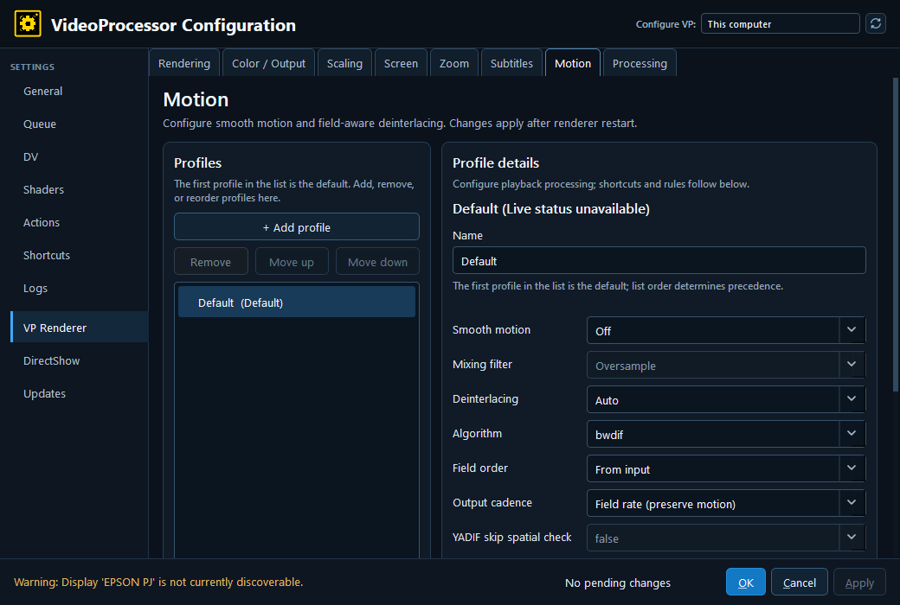

# DV2 deployment — 2026-10-14

Exact source: merged `dv2` tip `4c080e8d5f2d2d472c85ed1393aeeae5ff98db56`. [Release solution build](release-build.txt) passed; [199 focused native checks](native-tests.txt) passed. [Receipt](deployment.json) records every backed-up/replaced file and verified SHA-256 hash.

Backup: `C:\Videoprocessor\vp\deployment-backups\dv2-4c080e8d5f2d-20261014-133826`. Configuration and saved state stayed byte-identical. VP playback was not launched. Deployed Config opened and exited successfully using a disposable copy of active configuration, showing the new Motion defaults.

