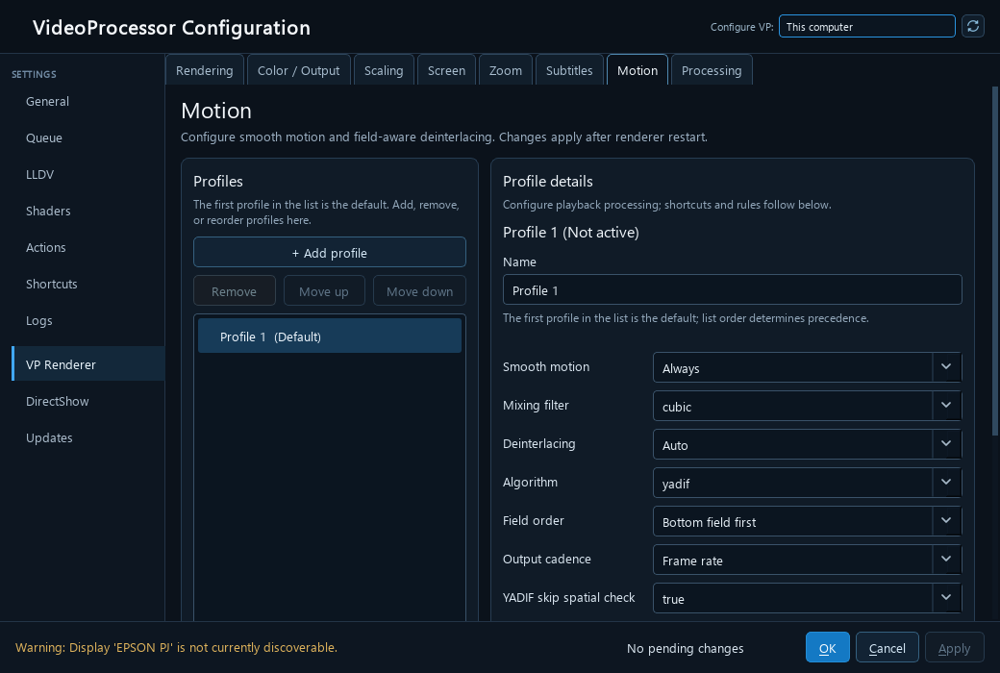

# Motion and chroma integration evidence

Merged into [beta PR #158](https://github.com/billslack2/videoprocessor/pull/158) and [DV2 PR #159](https://github.com/billslack2/videoprocessor/pull/159). Source identities and built binary hashes are recorded in [receipt](merge-receipt.json).

Both x64 Release solution builds passed. Beta: [259 native checks](beta-native-tests.txt). DV2: [324 native checks](dv2-native-tests.txt), including the existing tunnel, luminance, analysis diagnostics and subtitle/aspect-ratio reset contracts. Qt checks passed for Motion/chroma save/reopen, rapid tab navigation and every-page round trips on both; the retained DV/LLDV mode control also passed on DV2. Source trees at both merge commits match tested source commits.

Tests verify VP configuration and libplacebo wiring, not image quality. No deployment, playback restart, installer export or active configuration change. Source subtitle cut/paste composition bypasses motion with a diagnostic; native HDR passthrough remains deferred.

