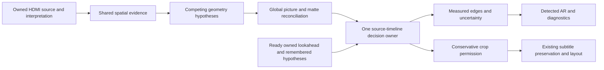

# Source-picture AR redesign: reviewed design, not an implementation

2026-11-01. Runtime/source baseline: 25a6abfd6cdc848a0380e71f4338d9b0479caa0f.
The current beta was discovered and fetched as v1.4.02-beta at a591ad3b; the
ongoing repair branch descends from that tip. Production source, runtime and
user configuration are unchanged by this review. The deployed candidate still
has the newly reported menu/scope failures. This document does not claim a fix.

## Agreed requirements and decision

Live HDMI movies/TV include genuine scope-to-IMAX and reverse transitions at
23.976, 59.94 and 60 input frames/s. Detect the source picture independently of
screen/CIH, fitting, zoom, subtitle mode and shader readiness. Interior black
regions are not necessarily encoded bars. Accept sufficient distributed shape
evidence despite darkness, imperfect black, partial occlusion and asymmetric
illumination. Preserve picture and captions without making caption geometry
native AR. Known/remembered ratios are current-evidence-backed hypotheses,
not required output ratios. A skipped analysis is not disappearance or a new
vote. Use already-owned ready lookahead without waiting for more input.

**Retain the proven source/ownership and caption machinery; replace competing
geometry decisions with one coherent evidence-to-decision flow.** This is a
modular consolidation, not a rewrite of capture, decoding or subtitle erasure.
Do not add another exception to the current 32-probe observer as the next fix.

## Evidence that must change the design

| Case | Established evidence | Design consequence |
|---|---|---|
| Netflix grid, capture082835 | All1476 logged physical observations select [136,332,3840,2160]. There are58,914 non-matte source pixels above332. Fixed32-column probes miss both avatar and logo. | A first broad internal edge is not a whole-picture boundary. Inspect the proposed exterior in two dimensions; preserve sparse components in candidate generation. |
| Grid outer margins | Native columns0..135 and rows0..58 are exactly Y64/U512/V512. | Rejecting top332 does not independently prove exact coordinates for blank UI margins. Full-canvas and matte hypotheses must be distinguished; forcing16:9 is not a measurement. |
| Scope meal shot, capture083046 | Fifteen saved frames are byte-identical: one paused scene. Real edges are263..1897. Bottom1897 has dense support[960,252,143,196] by width quarter;32 probes reduce this to[8,2,1,1]. Coarse search first accepts1826 and fine search1814..1838 never visits1897. | Candidate generation and confidence both fail. Collect competing edge candidates, adapt coverage and retain partial evidence; do not globally lower a brightness quota. |
| Previous source corpus |371 previously passing saved frames cover moving menu92, current paused scope64, original DV64, earlier DV56 and full-picture sun95. | Preserve those outcomes and deduplicate paused pixels when reporting scene diversity. Saved frames alone do not prove live transition latency. |
| Earlier floor defect | Physical presence used a classification cutoff already containing a margin, then added more contrast. | Give signal black, observed matte/noise, classification tolerance and preservation margin distinct meanings. |

Detailed factual reports remain in E:/codex/diagnostics/netflix-grid-boundary-20261101.
These are reproduced code/data failures, not guesses based only on screenshots.

## Current rule order: keep, replace, investigate

Paths refer to the reviewed source under src/VideoProcessor-Lib.

| Current owner/rule | Risk or useful property | Disposition |
|---|---|---|
| AnalysisFrame/AnalysisLumaSource; renderer PrepareFrameAnalysis at9137 | Immutable full-source interpretation, native strides/range/domain and source ownership. Ordinary V210 analysis bypasses display upload conversion. | Keep. Strengthen independent parity and format-transition gates. |
| ActivePictureEvidence ScanBlackLine at199 and Extract at1451 | Cheap nominations, but brightness/support quotas and initial search can miss dim/sparse structure. | Reuse sampling primitives; replace first-hit-only candidate policy. A coarse miss must not become proof of no picture. |
| Paired-edge symmetry at1726/1742 | Useful prior, unsafe as a universal condition for independently observed asymmetric picture. | Demote to optional hypothesis ranking, not a hard measurement veto. Keep asymmetric negative controls. |
| VerifyNativeAxisBands at486 and candidate verification at632 | Exact-source matte/continuation verification and explicit contradiction are valuable. Some strict tolerance/mismatch rules also gate geometry certainty. | Keep conservative discard checks. Separate their permission from physical edge estimation; calibrate any new measurement confidence against real positives/negatives. |
| Guard expansion/even alignment around1813..1845 | Protects uncertain/filtering pixels and chroma constraints. | Keep as downstream retained envelope. Never report the padded/aligned envelope as measured picture. |
| MeasurePhysicalPictureEdges at3808 | A second detector with32 probes, separate coarse/fine nominations, terminal proof and early all-or-none returns. | Replace its geometry ownership. Preserve useful local contrast/halo/sustain primitives behind common evidence contracts. |
| ActivePictureMeasurementCache at108..144 | Exact-source import and asynchronous observation are useful; physical search inherits proposed/trusted retention bounds. | Keep cache/identity discipline. Prior bounds may prioritize search, never exclude contradictory source regions. |
| Timeline and live transition models; renderer12163/12210 | Exact queued association and change provenance are necessary; independent geometric confirmation can diverge. | One logical transition state/history with queued/live adapters. No competing reconfirmation or old/new voting. |
| Native admission surrounded by caption/fitting conditions; AlphaSourceCropPolicy1009 | Protects output, but makes it difficult to tell whether a geometry decision is delayed by presentation policy. | Move presentation safety after the native decision. Keep separate output-preservation permission. |
| OSD physical observer vs applied native geometry | Different detectors can report a strong child rectangle and hold a different native ratio. | OSD reads the same decision packet, exposing measured/estimated/partial/held status and age. No independent detector for display. |
|80ms sparse cold clock and deadline checks | Cold acquisition may lag; an expired optional ticket may also abort handling of cached ready facts. The latter is a code-review risk, not yet a proved live cause. | Separate scheduling from consumption. Add deterministic tests before removing or replacing gates. |

## Proposed flow and ownership

1. **Interpret once.** Keep native coordinates and exact input identity/domain,
   declared range, storage precision, strides and immutable backing owner. Range
   metadata does not silently rescale pixel values. Explicitly tag nominal
   signal black, independently observed matte floor/noise, and legacy fallback
   reference, with source/mask/confidence. A legacy value with zero qualified
   edges is not a measured matte. Source/output dimensions
   remain separate. A partial or failed conversion cannot supply black pixels.

2. **Collect reusable spatial facts.** A bounded multiscale occupancy/contrast
   overview nominates regions; native samples refine their coordinates. Preserve
   sparse bright, dark and chroma structure rather than average it away. Compare
   coverage schemes and cost before choosing grid sizes. Every tile/probe carries
   coverage/completeness so unsampled pixels are not classified as matte.
   Use current and remembered edges to prioritize work, without constraining the
   only legal answer to their vicinity. Keep multiple candidate lines, local
   uncertainty intervals and which observations support each candidate.

3. **Reconcile geometry globally.** Each candidate must explain its proposed
   interior AND exterior. A long strong line inside a component cannot win while
   distributed picture exists outside it. Dark edge segments reduce information;
   they do not automatically contradict aligned support elsewhere. Preserve
   measured top/bottom/side facts separately, but never assemble four mutually
   incompatible edges or average two real boundaries into an invented one.
   Refine ambiguous native patches only where they can change the result.

   Local text/overlay morphology may explain an occluded border, using independent
   current source evidence. It must not use a semantic caption lease or the
   rendered subtitle backing as native geometry. Not every text cluster is a
   subtitle: menu labels belong to their canvas. A single caption, corner logo,
   thin progress bar or noise must not expand native AR. If a proposed crop
   excludes unexplained picture, it cannot be called strong or safely discarded.

   Full-canvas layout is a competing geometric explanation, not a forced16:9
   fallback or a title-specific menu classifier. For the grid fixture, preserving
   all header content is mandatory; replacing the false crop with indefinitely
   Unknown is not completion of the user's clear-menu acceptance case. The
   prototype must establish a source-supported canvas interpretation, using
   sequence evidence where blank margins are statically ambiguous. Do not call
   held history a fresh pixel measurement merely to satisfy the test.

4. **Associate once in source time.** One decision owner consumes the same
   immutable spatial results through queued/live adapters. SourceK can use
   already-ready owned successors to establish a transition effective atK;
   it must not wait for new arrivals or applyK's geometry toK-1. Read-only
   speculative model snapshots may evaluate future contributors; accepted live
   state commits once at the effective displayed source. Late work cannot roll
   it backward or advance it into the future. Known/remembered
   geometry may prioritize/rank supported hypotheses and reduce work. A supported
   estimate can be labelled approximate with an interval; exact edges cannot be
   invented from a standard aspect. Real current contradictions defeat history.

5. **Derive distinct outputs.** Physical measurement/uncertainty, conservative
   retained aperture and permitted discarded regions share evidence but have
   different authority. Pixel/chroma alignment and caption/fill/layout remain
   downstream. Current measured per-edge facts remain publishable even while
   temporal crop admission is pending; one decision owner must not hide fresh
   measurements behind a held display label. Existing subtitle proof, cleanup, leases, current-pixel checks
   and complete-image repeat remain intact. No renderer restart is a detection
   action. Shader compilation cannot block a native decision.

## Explicit outcome and transition rules

| Outcome | Meaning | Required behavior |
|---|---|---|
| Not measured | Skipped, pending, expired work ticket or unavailable input | No negative vote or fabricated measurement. Preserve state with original provenance; this alone grants no stale crop/cleanup on fresh pixels. Current safety evidence or the existing one-use complete-image repeat is still required. |
| Inconclusive/partial | Valid pixels, incomplete or competing geometry | Retain established positive edge facts and uncertainty; do not manufacture a complete strong rectangle. |
| Contradicted | Current non-caption picture disproves a candidate/exclusion | Withdraw that exclusion promptly. This is not automatically proof of another exact AR. |
| Measured/supported estimate | Coherent geometry with explicit precision and provenance | Publish measurement on its first supported source; separately authorize conservative crop only when its safety proof is ready. No added displayed-frame dwell or discarding an uncertainty band merely because an estimate exists. |

Expansion and inward cropping have different safety obligations: protecting
newly visible picture can precede precise refinement; discarding more picture
requires affirmative matte/occlusion evidence. That difference belongs in one
explicit policy, not stacked holds in multiple models. Never smooth rectangles
through non-existent intermediate ratios during a cut. A truly moving boundary
must remain representable as measured motion rather than forced onto a standard.

## Performance and timing contract

60Hz input allows16.667ms per source;59.94 allows16.683ms. Available lookahead
is existing buffering, not permission to add latency. Current optional render
analysis tickets are1ms when phase is unknown and at most2ms when qualified;
worker throughput and proof-ready lead are separate budgets. Consume exact ready
facts before spending optional work. A scan deadline stops new work, not a valid
already-ready proof. Bound memory, speculative jobs, feature size and refinement.

Reduced-rate expensive analysis is allowed only with explicit skipped-source
semantics and prompt current contradiction handling. Do not reduce cadence by
turning intermediate frames into Unknown/empty captions. Preserve original
repeat/image provenance without renewing leases or counting duplicates as votes.
Benchmark full input arrival, queue age, conversion completion, worker start/end,
proof-ready lead, effective source and actual output—not just detector average.
The new design has no measured performance result yet. Shadow runs must also
be bounded so doubled analysis does not create the starvation being investigated.
Before live shadow enablement, its reviewed configuration must assign numerical
CPU time, pending-job and additional-byte caps based on the offline benchmark.
Until those caps are selected and tested, shadow enablement is blocked. Use CPU
observation only, no duplicate GPU rendering, no added full-raster copy or queue
extension, and cancel low-priority refinement under presentation pressure.
Exhaustion is Not measured/partial, never absence of picture or successful proof.

## Input-conversion audit and verification

No new scaling/unpacking defect was found in the reviewed native paths. V210
analysis reads native packed source; the reviewed V210-to-P210 unpacking performs
no resampling, with selected packing/parity paths covered by the CPU tests.
This does not validate every hardware buffer, GPU upload or live format-switch race.
Decoded DV uses full-height12bit422 storage and intentional upper10bit analysis
codes. The new failures reproduce from saved native pixels before display scaling.

Thirteen existing CPU contracts were executed against the matching25a6abfd test
DLL:13/13 passed, exact method list validated, AVX2 supported and no DV AVX skip
reported. Tests cover independent packing, padded rows/tails, chroma rows, range,
precision, source ownership and Live/Queued/output-choice parity. They are not
all in today's mandatory critical manifest: add the cheap required subset before
any conversion changes. This is a validation gap, not proof of a hardware fault.
Remaining gaps: hardware buffer capacity is inferred from VideoState; DV stride
assumes the current tightly packed decoder; decoded captures do not independently
prove original HDMI tunnel bytes. A paired raw/decoded same-source capture is
needed if decoder interpretation becomes suspect.

## Primary-source comparisons

FFmpeg's black mode scans line averages with outlier handling and retains the
largest region until reset. Its motion/edge mode uses motion-vector bounds,
edge processing and a median window. Cropping alignment is applied separately.
Useful lessons are complete line coverage, explicit competing evidence and
keeping measurement apart from application rounding. An accumulating union
cannot follow shrinking picture immediately; a temporal median is not our
first-source transition contract. HDMI capture does not carry decoder motion
vectors, so that mode would require a separate estimator. These applicability
judgments are our inference from the [FFmpeg source](https://raw.githubusercontent.com/FFmpeg/FFmpeg/master/libavfilter/vf_cropdetect.c)
and [filter documentation](https://ffmpeg.org/ffmpeg-filters.html#cropdetect).

The official mpv script delays, samples cropdetect briefly, then applies a crop
and removes the detector; it warns about dark scenes. Useful separation of
measurement/application does not make it a continuous live-AR solution.
[mpv source](https://github.com/mpv-player/mpv/blob/master/TOOLS/lua/autocrop.lua).

HandBrake measures preview crops and aggregates per-edge results with selectable
policies. Matte coherence and broad pixel coverage are useful; offline preview
aggregation and8bit constants are not our live HDMI contract. Its output is a
comparator, not ground truth. [HandBrake source](https://github.com/HandBrake/HandBrake/blob/master/libhb/scan.c)
and [cropping documentation](https://handbrake.fr/docs/en/latest/advanced/resizing-video.html#cropping).
No upstream code has been copied. Pin comparator versions/settings before tests.

## Safe implementation sequence and removal gates

1. Freeze these requirements and annotate the real failure corpus. Add the
   missing cheap conversion gates and deterministic first-source timing tests.
   Keep private pixels outside Git; synthetic fixtures must reproduce the same
   failure, not merely a superficially similar rectangle.
2. Build a CPU-only common measurement prototype using existing source adapters
   and useful sampling primitives. Compare spatial evidence with native truth;
   do not change crop authority, subtitle behavior or runtime state.
3. Challenge it with asymmetric darkness, weak/raised/patterned bars, translated
   sampling phases, disconnected menus, real bars plus captions/logos/progress,
   fades, multiple true ARs and source format/rate changes. Preserve previous
   passing captures and correct nonstandard ratios. No title-specific constants.
4. Run bounded shadow observation and deterministic timeline integration. Keep
   old/new decisions separate; disagreement is diagnostic, never majority voting
   or a new fallback chain. Establish p95/p99 costs and actual source association.
5. Switch geometry authority at one interface, with one temporal owner and
   explicit adapters. Remove the superseded physical observer, duplicated
   nominations and redundant holds once their replacement contracts pass.
   Keep conservative discard and subtitle mechanisms until equivalent safety is
   demonstrated. Migrate or retire tests by requirement, not by implementation
   shape. No unconditional threshold relaxation or wholesale capture rewrite.
6. Validate paced23.976/59.94/60 input and actual renderer behavior on both
   dependencies, then qualified Release deployment and manual review. The
   existing intermittent Black startup gap remains separately recorded; this
   review neither fixes it nor uses it to justify unrelated subtitle changes.

## Decisive acceptance and additional data

- Scope263..1897 must measure correctly with uneven light and subtitles present
  or absent. Subtitle onset/offset must not change native AR.
- Menu grid must not crop away its header or accept the largest child panel.
  Full-canvas interpretation needs evidence, not retention masquerading as detection.
- Genuine letterbox/pillarbox/windowbox, asymmetric positions, dim collars and
  isolated overlays must retain correct measurement and preservation behavior.
- Scope→IMAX and reverse: mark first changed inputK, proof-ready time, adopted
  source and first correct submission. Zero added source delay when proof was
  already ready; no applying future geometry early. Unavailable evidence is
  reported separately from avoidable adoption delay.
- Deterministic CPU timing replay varies ready prefixes, budget0/expiry, out-of-order
  completion, repeats, backlog, seeks and generations; no sleeps or GPU required.
- Spatial tests vary probe phase and resolution, not only one aligned fixture.
  Compare unrounded source coordinates and uncertainty, not encoder-rounded crops.

Existing static captures are enough to design/reproduce the two current failures.
For final dynamic validation we need contiguous native frames around genuine
scope↔IMAX changes at23.976 and59.94/60, with source PTS and ready/dequeue/submit
trace. Current diagnostics sample native frames and cannot prove every-frame
latency. Use a bounded diagnostic burst containing all proof-contributor frames
plus cheaper every-source metadata/ROI summaries; define memory/disk limits
before enabling it. Do not request another arbitrary long capture without the
specific missing contract and capture strategy. HDMI raw/decoded pairing is a
separate targeted diagnostic if conversion parity evidence warrants it.

## Review outcome and open engineering choices

Three independent reviewers covered geometry/OSS, conversion and timing. Their
challenges are incorporated: retain incompatible hypotheses, avoid scalar-threshold
consolidation, do not force blank margins, preserve typed source provenance,
separate missing work from contradictory pixels, and bound shadow overhead.

The design direction is agreed by the reviewers; grid resolution, component/edge scoring,
per-edge precision thresholds, and full-canvas evidence criteria remain prototype
questions to resolve against the annotated corpus and negative controls. They
are not reasons to add production heuristics now. The next deliverable is the
failing-first CPU prototype and comparison report, not another deployed patch.

Final review record: geometry/OSS reviewer approved with the measurement-versus-
admission clarification; timing reviewer requested explicit stale-crop, speculative-
future, uncertainty-discard and shadow-budget guards, now incorporated. Conversion
reviewer verified exactly13 executed passing methods, summed method time1.0254s,
and no AVX2-skip report. No runtime implementation or deployment is part of this review.

## Supporting reviews

- [Geometry and rule ownership](adversarial-ownership-audit.md)
- [Input-to-analysis audit and exact test shortlist](INPUT_ANALYSIS_AUDIT.md)
- [Temporal/lookahead audit](temporal-lookahead-audit.md)
- [Primary OSS implementation review](primary-oss-crop-review.md)
- [Executed CPU conversion results](conversion-tests.json)
